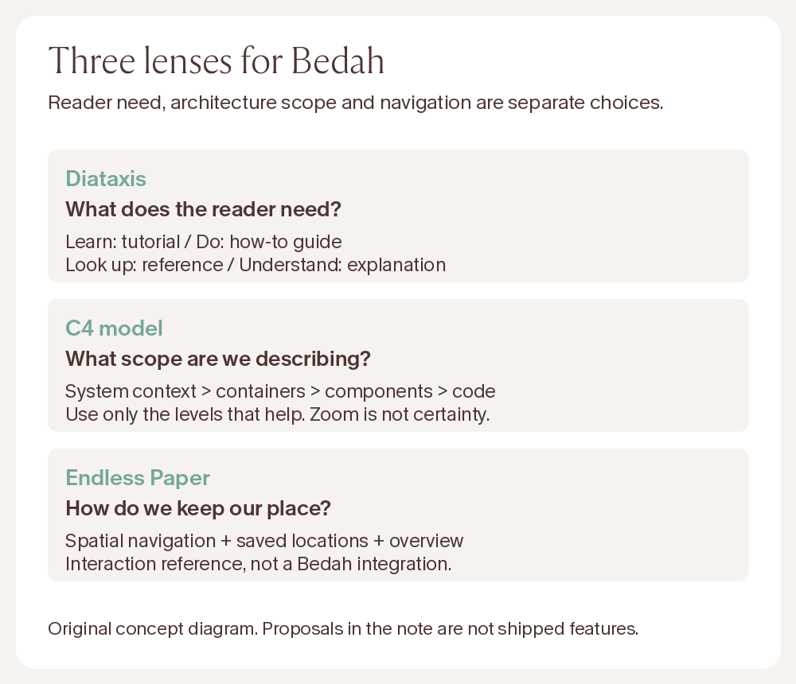

# Diátaxis, C4 and Endless Paper: three different jobs in Bedah

Status: source-based research and design proposals, not a feature release. Official pages checked 2026-11-19 (WIB). Bedah source inspected at `a0f44999c3befe891d5486239d7abb873b52da81`. Website behavior and screenshots were inspected; the Endless Paper iPad app was not installed or tested.

## Why these belong together

Diátaxis helps decide **what kind of help a reader needs**. C4 helps decide **which architectural scope a view describes**. Endless Paper offers an interaction reference for **moving through a spatial document without losing your place**. These are separate dimensions, not competing documentation frameworks.

*Original explanatory diagram for this note, not a screenshot of any product. Diátaxis concepts: Daniele Procida; C4 model: Simon Brown; spatial-navigation reference: Endless Paper. Sources below. No vendor artwork or interface assets are reproduced.*

## Diátaxis: organise around the reader's need

The [official introduction](https://diataxis.fr/) identifies four forms of documentation. The [five-minute primer](https://diataxis.fr/start-here/) distinguishes them by purpose, rather than by file format or length:

| Form | Reader's need | Possible Bedah document |
| --- | --- | --- |
| Tutorial | Learn by doing, with a guided successful experience | A first review of one small, fixed source snapshot |
| How-to guide | Accomplish a real task using existing skill | Refresh the generated map; review and flag a section |
| Reference | Look up accurate technical facts | Extracted declaration fields, edge kinds, supported parsers, persistence keys |
| Explanation | Understand context, choices and tradeoffs | Why a static reference is not a runtime call; why use a continuous map |

Tutorials and how-to guides both concern action, but a tutorial serves study while a how-to guide serves work. Reference and explanation both concern knowledge, but reference serves work while explanation serves study. A list of four headings alone does not apply the framework if each page still mixes these purposes.

**Fit to the current repo:** the README mixes orientation, generator commands and extraction reference. The existing research notes are mostly explanation. That is an inventory observation, not a claim that Bedah now has a complete Diátaxis documentation set.

**Proposal, not implemented:** give each future document one main reader need and link to the others. Keep the shortest safe action path in a how-to guide, with parser limitations in reference and design reasons in explanation. Start with one small improvement instead of moving every existing file into four empty folders. The official primer explicitly recommends incremental application.

## C4: separate scope from magnification

[Simon Brown's official C4 site](https://c4model.com/) describes hierarchical abstractions and diagrams, independent of notation and tooling. The core [diagram types](https://c4model.com/diagrams) are:

1. **System context:** the software system, its people and other systems around it.
2. **Containers:** the applications and data stores inside the system, with their relationships.
3. **Components:** the parts within a container and their responsibilities.
4. **Code:** implementation detail where it helps a reader.

A [C4 container](https://c4model.com/abstractions/container) is a runtime boundary, not a synonym for Docker, a directory, or a drawn rectangle. A browser application or command-line application can qualify. Build/deploy support should not silently become application runtime architecture. The official diagrams page says to use only levels that add value; context and container views suffice for most teams.

**Fit to the current repo:** `App.tsx` already declares people, external systems, a canvas application and manually run content generators. Build/deploy/docs are explicitly marked supporting, not runtime. `territory.tsx` and generated `src/code.ts` / `src/codemap.ts` provide the lower-level map. Bedah's section cards and file rooms are useful local navigation structures, not extra official C4 levels. The grouping and responsibilities are curated, while the source relations are static evidence, not observed runtime execution.

**Proposal, not implemented by this note:** audit each view against the official [notation checklist](https://c4model.com/diagrams/notation): title and scope, legend, element types, responsibilities and technology, plus directional and specific relationship labels. Preserve the source pin and evidence kind when crossing levels. More zoom must not suggest more certainty.

C4's zoom metaphor does not require one geometrically continuous canvas. That continuity is Bedah's interaction choice. It should be judged separately: can a reader answer the architecture question at each level, rather than merely see smaller boxes?

## Endless Paper: keep a sense of place

The [official product site](https://endlesspaper.app/) presents an iPad and Apple Pencil drawing/notetaking app built around an infinite canvas, pan and pinch navigation, and spatial organisation instead of fixed document pages. These are vendor descriptions, not performance measurements from this review. In particular, its advertised rendering speed and scale are not benchmarks for Bedah.

The [manual](https://endlesspaper.app/manual.html) offers a more concrete navigation lesson:

- Bookmarks save canvas locations and can be organised into folders and presentations.
- Predefined locations include the origin, the start of the current session and an overview of the marked area.
- Internal bookmark links return to particular canvas locations.

The [web-integration page](https://endlesspaper.app/web-integration.html) describes a Web Experience (WebXP) as an online representation of a canvas that can be shared by link or embedded. That is a property of its product, not an integration that Bedah has acquired.

**Fit to the current repo:** Bedah already has pan/zoom, a saved camera, fixed lower-level territory and focus controls. It is a source-review map, not a drawing app. Its code sets bounded zoom (`ZMIN = 0.07`, `ZMAX = 16`); the phrase "infinite canvas" in the README describes the interaction style, not an unlimited-precision or unlimited-content guarantee. Upper-level layouts also adapt to the visible viewport, so the whole interface should not be described as geometrically fixed at every level. Saved state is browser-local through `files-shim.tsx`, not a shared review database or cross-device backup.

**Ideas to evaluate, not implemented:** named review locations, a return-to-previous-view action, and a clear overview/recovery route. A useful evaluation would ask a reviewer to find a declaration, visit another component, then return without searching again. Check mouse, touch and keyboard paths separately. Keep source identity in a saved location so a bookmark cannot silently point to a different declaration after regeneration.

Do not copy its drawing tools or add a hosted canvas dependency merely to borrow the spatial lesson. This docs addition installs nothing, creates no service account and changes no sharing or persistence behavior.

## What this changes, and what it does not

This note adds sources, a comparison and bounded proposals. It does not reorganise the whole documentation tree, change the canvas, add bookmarks, regenerate the pinned code map, or establish C4 compliance. Existing features and stored review state are untouched. The map remains tied to the commit displayed in the UI, not automatically to this newer documentation commit.

A sensible next documentation step would be a short first-review tutorial with a fixed snapshot, linked to the existing extraction explanation and a separate edge-kind reference. That is a suggestion, not work claimed as complete or a commitment to implement it.

## Sources and limits

All sources below are first-party material. They establish the frameworks' definitions and the vendor's documented interface, not independent usability or performance results. This is a focused reading of the three requested references, not an exhaustive tool comparison.

- Diátaxis, official overview: <https://diataxis.fr/>
- Diátaxis, authorship: <https://diataxis.fr/colophon/>
- Diátaxis, five-minute primer: <https://diataxis.fr/start-here/>
- C4 model, official overview by Simon Brown: <https://c4model.com/>
- C4, diagram types and selective use of levels: <https://c4model.com/diagrams>
- C4, container definition: <https://c4model.com/abstractions/container>
- C4, notation checklist: <https://c4model.com/diagrams/notation>
- Endless Paper, product overview: <https://endlesspaper.app/>
- Endless Paper, manual, especially Bookmark Menu: <https://endlesspaper.app/manual.html#bookmark-menu>
- Endless Paper, web integration: <https://endlesspaper.app/web-integration.html>

Bedah evidence: `README.md`, `App.tsx`, `territory.tsx`, `files-shim.tsx`, and `.github/workflows/deploy.yml` at the source commit named above. No private chats, user review marks, credentials or third-party contributions are included.
